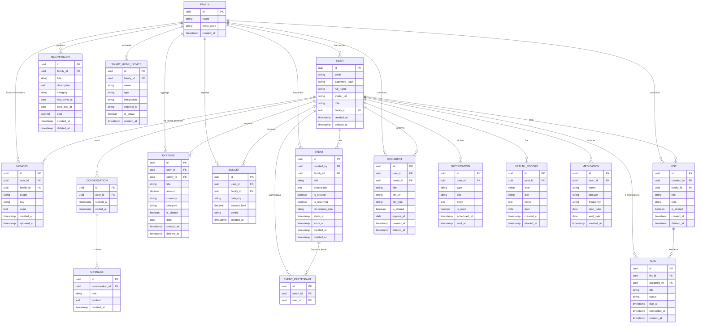

# ERD — Alfy: Entity Relationship Diagram

**Versione:** 0.1 (Draft)
**Data:** Marzo 2026
**Autore:** Sergio
**Stato:** In revisione

---

## Diagramma

---

## Descrizione delle Entità

### USER
Rappresenta ogni persona registrata su Alfy. Ogni utente appartiene a esattamente una famiglia. Il campo `role` può essere `admin` o `member`. Il campo `deleted_at` permette il soft delete dell'account mantenendo lo storico dei dati associati.

### FAMILY
Il nucleo familiare. Contiene un `invite_code` generato automaticamente per invitare nuovi membri. Un utente che si registra senza codice crea una nuova famiglia da solo.

### MEMORY
È il sistema di memoria persistente di Alfy. Ogni ricordo ha uno `scope` (`personal` o `family`) e una coppia chiave-valore (`key`, `value`) che Alfy popola nel tempo. Esempi: `allergie: nichel`, `giorno_stipendio: 27`, `nome_animale: Luna`. Alfy legge questa tabella a ogni conversazione per contestualizzare le risposte.

### CONVERSATION / MESSAGE
Storico delle conversazioni con Alfy. Ogni conversazione è una sessione. I messaggi hanno un `role` (`user` o `assistant`) coerente con il formato delle API AI. Lo storico è usato per il contesto a breve termine all'interno di una sessione.

### EXPENSE
Ogni uscita o entrata registrata. Il campo `is_shared` distingue le spese personali da quelle familiari. Il soft delete (`deleted_at`) preserva lo storico finanziario.

### BUDGET
Limite di spesa impostato per categoria e periodo (`monthly`, `weekly`, `yearly`). Può essere personale o familiare.

### EVENT
Appuntamento o evento in calendario. Il campo `recurrence_rule` usa il formato iCal (es. `FREQ=WEEKLY;BYDAY=MO`) per gli eventi ricorrenti. Il soft delete preserva lo storico degli appuntamenti passati.

### EVENT_PARTICIPANT
Tabella di giunzione molti-a-molti tra EVENT e USER. Permette di associare più partecipanti a un evento condiviso.

### LIST
Contenitore di task. Il campo `type` può essere `shopping`, `todo`, `chores` o `custom`. Le liste possono essere personali o condivise.

### TASK
Singolo elemento di una lista. Il campo `status` può essere `todo`, `in_progress`, `done`. L'eliminazione dei task completati è definitiva dopo un periodo di grazia configurabile.

### DOCUMENT
File archiviato (foto, PDF, altri). Il campo `expires_at` permette ad Alfy di generare notifiche proattive sulle scadenze documentali. Il soft delete preserva lo storico.

### NOTIFICATION
Notifica generata dal sistema proattivo di Alfy. Il campo `scheduled_at` permette di pianificare notifiche future. Una volta letta (`is_read: true`) e trascorsa, la notifica viene eliminata definitivamente.

### MAINTENANCE
Registro degli interventi di manutenzione su casa e veicoli. Il campo `next_due_at` è usato dal sistema proattivo per generare promemoria. Il soft delete preserva lo storico.

### HEALTH_RECORD
Singolo evento sanitario (visita medica, esame, ricovero). Il campo `type` può essere `appointment`, `exam`, `prescription`, `other`. Sempre soft delete per ragioni di sensibilità dei dati.

### MEDICATION
Farmaco assunto regolarmente da un membro della famiglia. Alfy usa `frequency` e `start_date` / `end_date` per generare promemoria di assunzione o di riacquisto.

### SMART_HOME_DEVICE
Dispositivo smart collegato tramite integrazione esterna. Il campo `integration` indica il sistema usato (`home_assistant`, `google_home`, `matter`). Il campo `external_id` è l'identificativo del dispositivo nel sistema esterno.

---

## Politica di Eliminazione dei Dati

| Entità | Tipo di delete | Motivazione |
|--------|---------------|-------------|
| USER | Soft | Preserva lo storico dei dati associati |
| EXPENSE | Soft | Storico finanziario necessario |
| EVENT | Soft | Storico appuntamenti passati |
| DOCUMENT | Soft | Storico documentale |
| MAINTENANCE | Soft | Storico interventi |
| HEALTH_RECORD | Soft | Dati sensibili, sempre preservati |
| LIST | Soft | Può contenere task ancora attivi |
| TASK (completato) | Hard (dopo 30gg) | Dato operativo, non storico |
| NOTIFICATION (letta) | Hard | Dato effimero |
| MESSAGE | Hard (dopo 90gg) | Gestione contesto, non archivio |
| MEMORY | Hard | Aggiornamento continuo, no storico |

---

*Documento soggetto a revisione. L'ERD verrà aggiornato durante la fase di sviluppo al manifestarsi di nuove esigenze.*
